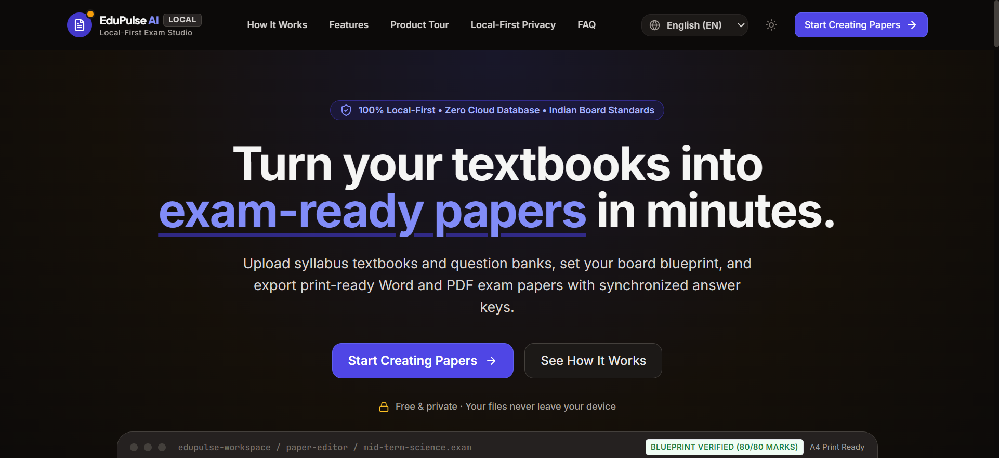
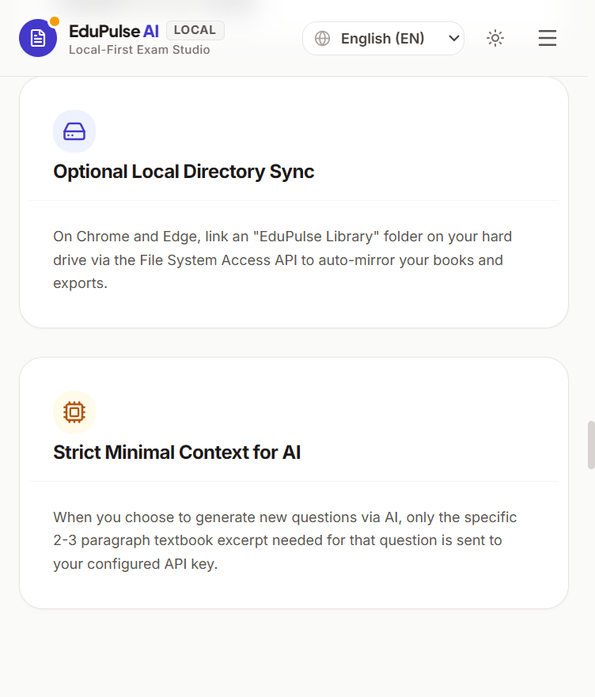
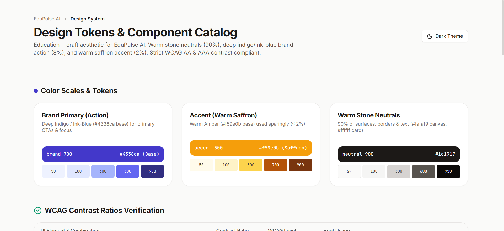
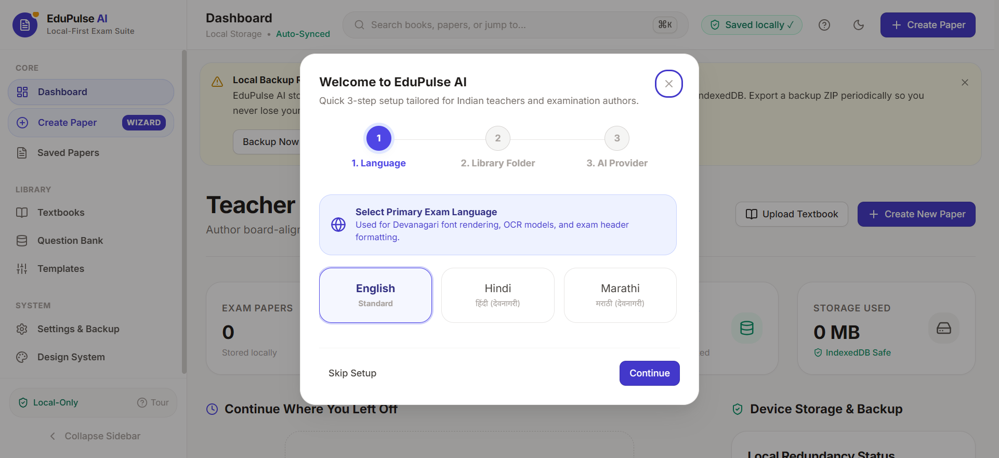
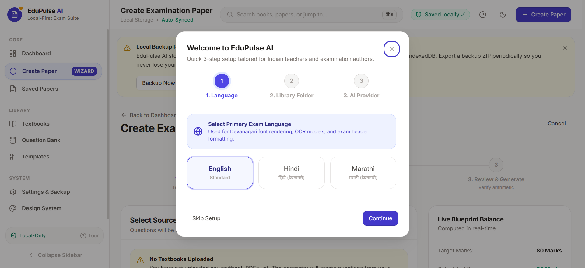

# EduPulse AI — Local-First Teacher Exam & Paper Generation Suite

[](https://react.dev/)
[](https://www.typescriptlang.org/)
[](https://vitejs.dev/)
[](https://dexie.org/)
[](https://vitest.dev/)
[](https://developer.chrome.com/docs/lighthouse/)
[](https://developer.chrome.com/docs/lighthouse/)
[](https://developer.chrome.com/docs/lighthouse/)

> **EduPulse AI** is a **100% local-first, privacy-focused assessment engineering app for Indian school teachers**.
> Upload textbooks and question banks, design mathematically deterministic blueprints, generate balanced board-accurate exam papers (+ answer keys), customize questions in an inline editor, and export to print-ready PDF and Microsoft Word (.docx).
>
> **Zero cloud database. Zero user accounts. Zero telemetry.** Everything lives strictly in your browser's IndexedDB and optional local folder.

---

## 📸 Product Showcase & Screenshots

### 1. Public Landing Page (`/`)
Built for speed, clarity, and trust. Designed with a calm education-and-craft aesthetic with trilingual support (English, Hindi, Marathi) and zero heavy document processing libraries loaded upfront.

| Desktop Light Mode | Desktop Dark Mode |
| :---: | :---: |
|  |  |

| Mobile Responsive View | Design System Catalog (`/design-system`) |
| :---: | :---: |
|  |  |

### 2. Teacher Workspace (`/app/*`)
A focused, distraction-free environment for organizing textbook materials, configuring blueprints, and generating exam papers.

| Teacher Dashboard | Deterministic Blueprint Wizard |
| :---: | :---: |
|  |  |

---

## 🎨 Color System & Design Tokens

EduPulse AI implements a structured token system adhering to the **90 / 8 / 2 rule** (90% neutral surfaces, 8% brand primary, 2% saffron accent):

| Role | Token / Shade | Hex Value | WCAG Contrast | Usage |
| :--- | :--- | :--- | :--- | :--- |
| **Brand Primary** | `--color-brand-700` | `#4338ca` (Deep Indigo) | **8.1:1** on light (AAA) | Primary actions, selected navigation, key links, focus rings |
| **Warm Accent** | `--color-accent-amber` | `#f59e0b` (Saffron) | Used as badge / dot | Sparse highlights ($\le 2\%$), "New" tags, Indian context accent |
| **Page Canvas** | `--color-surface-canvas` | `#fafaf9` / `#141210` | 15.5:1 text contrast | Base page background (stone warm neutral) |
| **Card Surface** | `--color-surface` | `#ffffff` / `#1c1917` | Clean elevated card | Component surfaces, modals, drawers |
| **Border Subtle** | `--color-border-subtle` | `#e7e5e4` / `#292524` | 3:1+ edge contrast | Card outlines, dividers, clean 1px grids |
| **Text Primary** | `--color-text` | `#1c1917` / `#f5f5f4` | **15.5:1** (AAA) | Headings, questions, primary content |
| **Text Muted** | `--color-text-muted` | `#57534e` / `#a8a29e` | **5.5:1** (AA) | Secondary metadata, timestamps, helper text |

> **Design Principle**: No gradients on UI chrome (sidebar, headers, dialogs, buttons). Only a single subtle radial color wash (`.hero-wash`) is used in the public hero section.

---

## 🗺️ Application Routes & Code-Splitting Architecture

To guarantee instantaneous landing page load speeds and optimal Lighthouse scores, heavy dependencies are code-split via dynamic imports:

- **`/` — Public Landing Page**:
  - Extremely lightweight bundle (< 16 kB initial JS chunk).
  - Trilingual copy toggle (English, Hindi, Marathi) in `src/locales/landing.ts`.
  - Dynamic returning-user detection: checks local IndexedDB to offer an instant "Open Workspace" CTA.
  - Interactive HTML/CSS paper editor preview and FAQ accordion.
- **`/design-system` — Living Styleguide**:
  - Live token visualizer, contrast matrix table, interactive button states, form inputs, badges, and alerts.
- **`/app/*` — Teacher Workspace**:
  - Lazy-loaded via `React.lazy(() => import('./pages/AppWorkspace'))`.
  - Isolates heavy modules (`pdfjs-dist`, `tesseract.js`, `docx`, `minisearch`) so they are downloaded only when the teacher enters the workspace.

---

## 🧭 The Teacher Workflow

```
[ 1. Upload ] ──────> [ 2. Extract & Tag ] ──────> [ 3. Blueprint ]
  Textbook PDFs,        Client-side extraction,     Sections, marks,
  DOCX, or TXT          OCR fallback, chunks,       chapter weightage,
                        discrete question parser    deterministic math
                              │
                              ▼
[ 6. Saved Papers ] <─── [ 5. Edit & Export ] <─── [ 4. Generate ]
  Local paper hub,        Inline editor, swap,        Slot selection +
  filter, duplicate,      reorder, AI regen,          grounded textbook chunks,
  re-export, reuse        Word (.docx) & PDF          multi-set (Sets A/B/C)
```

---

## 🌟 Core Features

- 🔒 **100% Local-First Storage**:
  - Primary store: **IndexedDB (via Dexie.js v4)** for textbooks, raw blobs, chunks, question items, blueprints, and papers.
  - Native file sync: **File System Access API** (Chrome / Edge) directly writes to your chosen `EduPulse Library` folder (`/Textbooks`, `/QuestionBanks`, `/Papers`, `/Exports`).
  - Safari & Firefox fallback: One-click full **Backup ZIP** and **Restore from Backup** with data integrity validation.
  - Automatic persistence check: Calls `navigator.storage.persist()` on first launch.
  - Debounced 1-second autosave in Paper Editor with visual `Saved locally ✓` feedback.
- 📚 **In-Browser Ingestion Pipeline**:
  - Extracts text page-by-page using `pdfjs-dist`.
  - Scanned page detection (< 25 characters) with automatic `tesseract.js` OCR fallback for English, Hindi, and Marathi.
  - Automatic regex detection of chapter headers and exercise / practice sets.
  - In-browser BM25 semantic chunk retrieval powered by `MiniSearch` (no external vector database needed).
  - Question Bank parser with token-based Jaccard deduplication to eliminate repeated questions.
- 📐 **Deterministic Blueprint Builder**:
  - Code-enforced arithmetic: Section marks, question counts, and choice slots are computed deterministically.
  - Real-time arithmetic validation: Generation is strictly blocked if section marks do not equal total marks, or if chapter weightages / difficulty splits do not equal 100%.
  - Built-in starter templates for **CBSE Class 10 Science (80M)**, **CBSE Class 10 Math (80M)**, and **Maharashtra State Board Class 9 Algebra (40M)**.
- 🤖 **Bring-Your-Own-Key (BYOK) AI Engine**:
  - Supports **Google Gemini 2.0 Flash / Pro**, **OpenAI GPT-4o / GPT-4o-mini**, and **Anthropic Claude 3.5 Sonnet**.
  - Keys are stored securely in client-side IndexedDB with a one-click connection test button.
  - Grounded prompts: Only retrieved textbook chunks are sent to the AI; whole textbooks never leave the device.
  - Strict Zod schema validation with automatic JSON repair for trailing commas and formatting quirks.
  - **MCQ Invariant Enforcement**: All multiple-choice questions are guaranteed to have exactly 4 options and exactly 1 correct answer.
  - **Offline Fallback**: Seamlessly generates complete exam papers strictly from the local question bank if offline or without an API key.
- 📝 **Live Paper Editor**:
  - Inline question text, marks, explanation, and option editing.
  - Swap questions directly with matches from the question bank.
  - Single-question AI regeneration with difficulty and Bloom level tuning.
  - Move questions up/down and delete with undo/redo history.
  - Shuffled multi-set generation (**Set A, Set B, Set C**) with synchronized answer keys.
- 🖨️ **Professional Print & Document Export**:
  - **Print-ready PDF** formatted with standard Indian school exam layout (School header, Roll No box, general instructions, section headings, and page marks).
  - **Devanagari Font Support**: Embeds `Noto Sans Devanagari` to guarantee Hindi and Marathi text renders crisply without missing glyphs.
  - **Microsoft Word (.docx)** export using the `docx` library for both Question Paper and Model Answer Key / Marking Scheme.
  - **JSON Export / Import** for paper portability.

---

## 🏛️ Local-First Architecture

```
┌────────────────────────────────────────────────────────────────────────┐
│                        EduPulse AI Client (Browser)                    │
│                                                                        │
│   React 18 + Tailwind UI ──► AppContext (View & State Management)       │
│                                                                        │
│   ┌──────────────────────────┐      ┌──────────────────────────────┐   │
│   │ Ingestion Pipeline       │      │ Deterministic Engine         │   │
│   │ • pdfjs-dist extraction  │      │ • Blueprint Arithmetic Check │   │
│   │ • tesseract.js OCR       │      │ • Jaccard Similarity Dedupe  │   │
│   │ • Semantic Chunker       │      │ • MiniSearch BM25 Retrieval  │   │
│   │ • Discrete QB Parser     │      │ • Multi-Set Shuffler (A/B/C) │   │
│   └────────────┬─────────────┘      └──────────────┬───────────────┘   │
│                │                                   │                   │
│   ┌────────────▼───────────────────────────────────▼───────────────┐   │
│   │                  IndexedDB (Dexie.js v4)                       │   │
│   │  Tables: textbooks, chapters, textbookChunks, questionBank,   │   │
│   │          blueprints, savedPapers, drafts, settings             │   │
│   └────────────┬───────────────────────────────────────────────────┘   │
│                │                                                       │
│   ┌────────────▼──────────────┐             ┌──────────────────────┐   │
│   │ File System Access API    │             │ External AI (BYOK)   │   │
│   │ /EduPulse Library         │             │ Minimal snippets only│   │
│   │  ├── /Textbooks           │             │ • Google Gemini      │   │
│   │  ├── /QuestionBanks       │             │ • OpenAI             │   │
│   │  ├── /Papers              │             │ • Anthropic          │   │
│   │  └── /Exports             │             └──────────────────────┘   │
│   └───────────────────────────┘                                        │
└────────────────────────────────────────────────────────────────────────┘
```

---

## 💻 Quick Start for Teachers

1. **Upload Textbook / Question Bank**:
   - Navigate to the **Textbooks** tab and drop your textbook PDF.
   - Wait for client-side text extraction and chapter indexing.
   - Review or customize chapter ranges in the **Chapter Manager**.
2. **Configure AI Key (Optional)**:
   - Click the **Settings** gear in the top right.
   - Enter your Gemini, OpenAI, or Anthropic API key and click **Test Key**.
   - *(Note: If you have no key, you can still assemble papers from your Question Bank!)*
3. **Pick or Customize a Blueprint**:
   - Go to **Blueprints** and select a template (e.g. CBSE Class 10 Science 80M).
   - Adjust question counts, marks, and chapter weightages. Watch the live arithmetic validation pill turn green.
4. **Generate & Edit**:
   - Click **Generate Examination Paper**.
   - The app matches questions from your question bank and generates new textbook-grounded questions for remaining slots.
   - In the **Paper Editor**, tweak wording, swap questions from your bank, or regenerate questions.
5. **Export & Print**:
   - Click **Export DOCX** for an editable Word document or **Print PDF** for a print-ready exam paper and answer key.

---

## 💾 Backup, Restore, and Local Storage Details

### Chromium (Chrome, Edge, Brave, Opera)
- Click **Settings** -> **Select Library Folder** to choose a folder on your computer (e.g., `Documents/EduPulse Library`).
- All uploaded textbooks, parsed question banks, blueprints, and exported Word/PDF papers will be written directly to your disk.

### Safari & Firefox (or when folder access is not granted)
- EduPulse persists everything in your browser's IndexedDB.
- To prevent accidental browser data clearing (e.g. clearing browser cache), click **Backup All Data (ZIP)** in Settings.
- You can restore your entire library on any computer at any time using **Restore from Backup ZIP**.

### Storage Quota & Eviction Protection
- EduPulse calls `navigator.storage.persist()` on launch to request that the browser treat your storage as persistent.
- You can view your exact storage quota and usage in the **Settings** dialog.
- A reminder banner automatically notifies you if you have not created a backup in over 7 days or after generating 3 new papers.

---

## 🛠️ Development & Testing

### Prerequisites
- Node.js 18+ or 20+
- npm 9+

### Installation & Run
```bash
# Clone the repository
git clone https://github.com/anujtiwari1427/quiz-ai.git
cd quiz-ai

# Install dependencies
npm install

# Start development server
npm run dev
```

### Production Build & Typecheck
```bash
npm run build
```

### Run Unit Tests
```bash
npm test
```

Unit test coverage verifies:
- Deterministic blueprint arithmetic and section marks totals.
- MCQ invariants (4 options, exactly 1 correct answer).
- Token-based Jaccard deduplication.
- Chapter header and exercise regex extraction.
- Backup ZIP manifest serialization and round-trip parsing.

---

## 📄 License & Privacy
- **Privacy First**: No telemetry, no third-party tracker, no cloud database.
- **Fair Use**: Teachers must confirm educational fair-use rights for copyrighted textbook materials upon upload. Text snippets are transmitted strictly to the teacher's selected AI provider endpoint.
